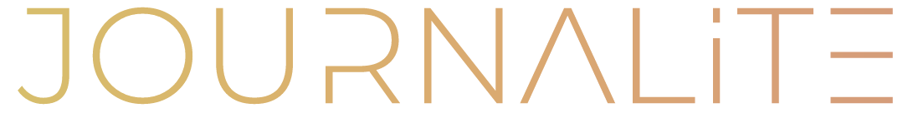

# Journalite
#### Diario de Tareas y Evidencias Fotográficas

### Integrantes de equipo

- Alina Valeria Franco Gutiérrez
- Gael Orian Acevedo Miralles
- Paola Castillo Pérez

**Materia:** Programación de Dispositivos Móviles  
**Lenguaje / Plataforma:** Java — Android Studio (SDK 26+)

### Descripción del proyecto
**Journalite** es una aplicación móvil para Android diseñada con un enfoque autodidacta para estudiantes universitarios. A diferencia de las plataformas institucionales formales, como Canvas, Journalite ayuda a gestionar repasos personales, metas de estudio y apuntes fotografiados en clase organizados por materia, evitando que se pierdan en la galería general del teléfono.

Como regla principal de negocio, ninguna tarea puede marcarse como completada sin antes capturar una fotografía real como evidencia, certificando la fecha y hora de estudio mediante metadatos EXIF y confirmando la acción con retroalimentación háptica.

---

### Funcionalidades y tecnologías móviles integradas
- **Persistencia local (SQLite):** Almacenamiento estructurado y 100% offline mediante `SQLiteOpenHelper` (`journalite.db`), con consultas filtradas dinámicamente por materia y estado (`PENDIENTE` / `COMPLETADA`).
- **Cámara y almacenamiento(`FileProvider`):** Captura directa de evidencia fotográfica guardada en el directorio privado de la aplicación.
- **Interpretación de metadatos (`ExifInterface`):** Extracción automática de la fecha y hora exacta de captura (`TAG_DATETIME`) para validar la autenticidad de la evidencia.
- **Notificaciones programadas (`AlarmManager` + `NotificationCompat`):** Recordatorios locales en fecha y hora específica para el repaso de apuntes por materia.
- **Confirmación por vibración (`Vibrator`):** Confirmación física mediante vibración corta al registrar exitosamente una evidencia.

---

### Estructura del repositorio
- `app/` — Código fuente completo en Java, layouts XML y recursos de Android Studio.
- `Documentacion/` — Entregables en formato PDF, script fuente de la base de datos (`journalite_db.sql`) y capturas de pantalla / diagramas.

### Link de documentos

- Modelo de base de datos: https://docs.google.com/document/d/1NdfaklhSnLf6QGdEKMffGmvt-6i2Wvv4ryUd4UJSz78/edit?usp=sharing
- Documento de requerimientos: https://docs.google.com/document/d/1oiLijUn2eX258Dmev_APnWs05JZKa2Zxhb9ouFbIxSc/edit?tab=t.0
- Prototipo de interfaz: https://docs.google.com/document/d/1t6jKIAFSJujWVwd_Ts9wnUcMe9BUgD6Vm0-84zLo6sI/edit?tab=t.0
